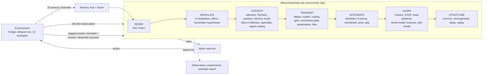

# SONAPSE-EVO NeuroWeave Evolution Layer (3.0.0)

An additive research layer built next to SONAPSE-EVO 2.0. It adapts the mechanisms of
[NEUROWEAVE-LAB 0.4.0](https://github.com/kai9987kai/NEUROWEAVE-LAB) to the SONAPSE-EVO substrate and
extends them. SONAPSE-EVO stays the primary architecture: nothing was removed, replaced or simplified,
and every new mechanism is an independent switch that is **off by default**.

> **Evidence boundary.** Everything here is a synthetic computational abstraction. Biological words
> (dendrite, soma, dopamine, astrocyte, myelin) name the role of a state variable; none of it is a validated
> biophysical model, a real connectome, hardware, or evidence of subjective experience. A mechanism can
> help, do nothing, or hurt. The measured outcomes are in [NEUROWEAVE_RESULTS.md](NEUROWEAVE_RESULTS.md).

Related documents: [feature matrix and requirement coverage](NEUROWEAVE_FEATURE_MATRIX.md) ·
[mechanism catalogue](NEUROWEAVE_MECHANISMS.md) · [measured results](NEUROWEAVE_RESULTS.md).

## 1. What did not change

The original package is intact: `RecurrentSubstrate`, `TopologyState`, `GraphTopology`, the lesion
engine, the four graft types, the 20 structural operators, Mode A repair, Mode B discovery, the 10-arm
benchmark, criticality, causal interventions, the curriculum, the observatory and every CLI command.
Three existing files were edited, additively only:

| File | Change |
|---|---|
| `cli.py` | registers the new sub-commands; adds an optional `--host` to `serve` (default unchanged) |
| `observatory/server.py` | `run_server` gains an optional `host` argument and serves the extra page when available |
| `observatory/web/index.html` | one link to the new observatory page |

The baseline is recoverable at any time: git tag `baseline/sonapse-evo-2.0.0`.

## 2. Integration architecture

`WeaveSubstrate` **subclasses** `RecurrentSubstrate`, so everything that accepts the original substrate
(lesions, grafts, the transaction manager, criticality, causal probes, matched controls, benchmarks)
accepts it unchanged. With no mechanism enabled every overridden method delegates to the parent.



* **Typed, versioned interfaces** (`neuroweave/contracts.py`): `StepContext` (the per-step blackboard),
  `Mechanism` (plug-in base class), `SharedSignals`, `ModulatorState`, `AffectState`, `FeedbackSignal`,
  `Provenance`, `SignalKind`, and `INTERFACE_VERSIONS` recorded in every exported package.
* **Neutral-initialisation rule.** Every field a mechanism may write starts at the value that makes it a
  no-op (additive terms at exactly 0, multiplicative terms at exactly 1). The extended path evaluates the
  legacy expression in the same operation order, so a mechanism whose learned parameters are still zero
  changes nothing. This is tested bit-for-bit.
* **Event bus** (`neuroweave/events.py`): topic-based publish/subscribe (`weave.fault`,
  `plasticity.*`, `structure.*`, `memory.*`); a failing subscriber can never break the update loop.
* **Graceful degradation.** A mechanism whose import or hook fails is detached, recorded in
  `substrate.weave_faults`, announced with a warning, and the model keeps running (`strict=True` raises
  instead, and is what the tests use). Mechanisms look peers up at runtime and work without them.
* **Learned weave state is inert when switched off.** Weight deltas, grown synapses and compartment state
  live in weave-owned arrays; they never touch `base_w` / `plastic_w`.

## 3. Multi-compartment, multi-soma neurons (`neuroweave/cells.py`)

All compartments are residuals around the legacy drive `W r + B s + aux + bias`, so each one changes
temporal dynamics, saturation, gating or release rather than adding unbounded gain.

| Compartment | Role in the computation | Switch |
|---|---|---|
| Proximal dendrite | fast integration of feed-forward (sensory) current | `dendritic_compartments` |
| Distal dendrite | slower integration of recurrent current and the structural context message | `dendritic_compartments` |
| Apical dendrite | slow top-down context (attention, predictions, packets); multiplicatively gates the basal drive | `dendritic_compartments` |
| Basal dendrite | proximal + distal, saturating branch non-linearity | `dendritic_compartments` |
| Primary soma | the legacy rate itself (immediate integration) | always |
| Secondary soma | persistent low-pass trace of the primary (temporal context) | `multi_soma` |
| Fast / slow soma | onset emphasis (fast - slow) and long-window integration | `multi_soma` |
| Context soma | graph-neighbour and apical context | `multi_soma` |
| Integrator / burst soma | cross-compartment integrator; supra-threshold activity (drives the membrane) | `multi_soma`, `membrane_spiking` |
| Gating soma | state-dependent gain in [0.65, 1.35], driven by neuromodulators | `multi_soma` |
| Membrane | membrane proxy, adaptive threshold, refractory period, spike, calcium proxy | `membrane_spiking` |
| Axon | hillock, N branches (configurable), terminal release with a depleting resource; synapses belong to a branch (local vs long-range) | `axonal_branches` |
| Glia | homeostatic gain; astrocyte-like reservoir scaling output and incoming efficacy; myelin proxy | `homeostatic_governor`, `astrocyte_regulation`, `adaptive_conduction` |

Transmission-level mechanisms: per-synapse delay lines (longer for inter-region edges), myelin-dependent
delay shortening, context-adaptive routing gain in [0.62, 1.14] (centred so the resting gain is exactly
1), uncertainty gating in [0.58, 1], k-winner sparse coding, hierarchical temporal traces and local
predictive coding. The existing DSAG / dual-soma code of Sonapse-LAB is not part of this repository;
the primary/secondary relationship is implemented here as described above.

## 4. Connectome expansion (`neuroweave/connectome/`)

* **Region layouts.** `legacy_layout` (the existing three regions), `ten_region_layout` (visual, auditory,
  olfactory, gustatory, thermosensory, mechanosensory, interoceptive, association, memory, motor),
  `custom_layout` (any number of populations with their own size and inhibitory fraction).
* **Thirteen topology families** behind `build_topology(kind, ...)`: legacy, clustered small-world,
  hub-skewed, uniform random, degree-preserving shuffle, Erdos-Renyi, hub-capped, ring lattice,
  hierarchical modular, multi-region, dense multi-region, multi-scale regional, hybrid. Each returns an
  ordinary `TopologyState`, keeps the canonical sensorimotor pathway (so the existing benchmark and motor
  read-out work on any graph), and scales by degree rather than density.
* **Metrics** (`compute_graph_metrics`): degree distributions, clustering, modularity, path length,
  global efficiency, hub concentration, inter-region density and regional communication efficiency.
* **Region routing** (`multi_region_routing`): region-pair gains over named pathways (sensory to
  association, association to memory, memory to action, feedback, predictive feedback).
* **Lesion library** (`connectome/lesions.py`): seven lesion families, matched random controls,
  progressive schedules and receipts. Works on the original substrate too.
* **Scalability.** Populations from 60 to tens of thousands of neurons; all mechanisms are O(N + E).

## 5. Multi-representational communication: NeuroWave-X2 (`neuroweave/comm/`)

Regions exchange typed, versioned `SignalPacket`s carrying sixteen simultaneous representations of the
same state: scalar, vector, spectral, phase, temporal, spatial, graph, sparse (SDR), vector-symbolic,
event, population-coded, context, predictive, uncertainty, multi-channel compartment and hybrid. Each
packet has a representation contract, timestamp, target compartment and soma, confidence, uncertainty
and provenance. The fusion layer's gates start at exactly zero (the scalar pathway is untouched) and are
then configured or learned by reward-correlated gate perturbation. Also here: the structural encoder
(16-feature graph fingerprints), connectivity-context attention and FlyHash-style sparse projection.

## 6. Plasticity and structural evolution

| Mechanism | Rule (bounded, sign-preserving through one shared update path) |
|---|---|
| `reward_gated_plasticity` | sparse eligibility traces gated by lagged reward and modulators; a second mode is a sparse port of the existing dense `NeuromodulatedPlasticityEngine`, including its fan-in bound |
| `pair_stdp` | pre/post spike traces; classical causal timing by default, the NEUROWEAVE timing as an option |
| `meta_plasticity` | per-synapse learning-rate scale from activity history, consolidation and sign agreement |
| `sleep_consolidation` | periodic replay, consolidation and downscaling; replay and downscaling switch independently |
| `structural_plasticity` | utility-guided pruning and co-activity-guided regrowth under an edge budget, with an audit ledger, `revert()`, and a bridge into the existing `GraphTopology` |
| `neurogenesis` | demand-gated repurposing of under-used neurons into a new recurrent sub-network of the region that needs capacity; `grow_substrate` returns a new, larger model and leaves the source untouched |

Safeguards: cooldowns, per-event batch sizes, lifetime budgets, edge caps and a demand gate. Every
structural change records why it happened (the score or demand that triggered it).

## 7. Neuromodulation and affective control (`neuroweave/neuromod/`)

Six modulator-like fields (dopamine, serotonin, acetylcholine, noradrenaline, octopamine,
endocannabinoid) with eight heterogeneous, regionally biased receptor sensitivities per neuron. Five
affect-like control variables. All are operational and individually ablatable:

| Signal | Effect on computation |
|---|---|
| dopamine | third factor of plasticity; gating-soma drive |
| acetylcholine | plasticity gain, sensory weighting (attention), consolidation gate |
| noradrenaline | output gain, plasticity gain |
| serotonin | gating, consolidation gate |
| octopamine / endocannabinoid | local gating; plasticity suppression |
| curiosity | exploration noise in the agent loop |
| stress | lower spike threshold, higher attention gain |
| motivation | action persistence |
| valence | scales reward-related learning |
| arousal | integration leak (response dynamics) |

`clamp_values` pins any modulator or affect variable for intervention experiments. The existing
four-field `NeuromodulatoryState` is bridged in both directions (`ModulatorState.to_legacy` /
`from_legacy`).

## 8. Sensory system (`neuroweave/sensory/`)

Sixteen channels in the NEUROWEAVE order (five visual, three auditory, olfactory, gustatory, thermal,
interoceptive, proprioceptive, mechanical, environment state, task context). The existing 155-dim
observation is unchanged; the channels enter through their own sparse projection onto sensory neurons
(modality-specific regions on a ten-region connectome). Each channel can be enabled, disabled, simulated
or externally supplied. Cross-modal fusion adds online sensory prediction, prediction error,
reliability weighting, staleness discounting, attention and imputation of missing channels.

**Privacy.** Camera frames and audio are reduced to a handful of numbers (in the browser for the
observatory, in `VisualFeatureExtractor` / `AudioFeatureExtractor` for Python) and discarded. No endpoint
accepts raw media, no state dict or package contains it, and an imputed value is always labelled as a
prediction.

## 9. Micro-Collective and specialist graft (`neuroweave/collective/`)

A freshly initialised mixture of experts (default four experts, top-2 routing, expandable) trained
online to predict the next sensory vector, with bounded replay, held-out validation, best-state
snapshots, rollback and a training receipt. Its prediction reaches the connectome only in proportion to
its measured skill against the persistence baseline, so an untrained model contributes exactly nothing.
A separately trained Supermix-inspired specialist is attached through an explicit, removable graft
interface. No external checkpoint is used or assumed. A parameter-matched dense baseline and a
persistence baseline are provided for fair comparison.

## 10. Predictive processing and self-model (`neuroweave/predictive/`)

* **World model**: an ensemble of action-conditioned forward models; member disagreement is the
  uncertainty signal; an inverse model predicts actions; `counterfactual` and `rollout` evaluate
  alternatives on the model only.
* **Prediction horizons**: predictors at 1, 4, 16 and 64 steps over fast / medium / slow traces; the
  active horizon shortens when uncertainty or surprise rises. Predictive feedback gain starts at 0.
* **Self-model**: compares intended action, issued command, predicted outcome and observed outcome to
  estimate authorship, disturbance, actuator slip and control reliability, which then discount learning
  credit and persistence.

## 11. Memory ecology (`neuroweave/memory/`)

Working, episodic, semantic and predictive stores with sparse distributed indexing, contextual
retrieval, confidence, interference tracking, consolidation, replay scheduling, forgetting and
downscaling hooks and cross-region sharing; plus the associative trace memory and fast weights of
NEUROWEAVE. **Provenance is mandatory**: direct sensory, internal prediction, external, prior experience
or synthetic simulation. A prediction can never be marked verified; when reality confirms it, a new
observed record is created that points back at it.

## 12. Environments (`neuroweave/ecology/`)

The 1200 x 660 ecology (moving obstacles, replenishing food, thermal zones, energy, collisions, goals)
and eleven further presets: dense obstacles, sparse or clustered resources, thermal gradient, wind and
actuator slip, dynamic conditions, rule shifts, long-horizon waypoints, memory-dependent navigation, a
small arena and a corridor; plus a multi-agent ecology. They use the existing observation and action
conventions, so the existing controller runs on them, and they are additional entries in one registry
that also lists the two existing tasks.

## 13. Experiments, lesions and promotion (`neuroweave/experiments/`, `promotion.py`)

Twenty-four catalogued experiments, each a hypothesis with a matched baseline. The framework trains,
freezes, and evaluates on held-out seeds; reports paired differences, effect size and a bootstrap
interval using the existing statistics module; supports ablation arms; measures cost; and writes a
JSON receipt plus CSV. A verdict requires at least five paired seeds in either direction; fewer is
always `inconclusive`.

**Primary metric.** The existing `forage` task pays a positive reward on every step, so an agent that
reaches the goal more slowly collects more return. Return is therefore not a measure of competence on
that task. Experiments on `forage` use **goal efficiency** (`success * (1 - (steps - 1) / max_steps)`)
as the primary metric and report return as a secondary comparison; the ecology tasks, whose step
reward is negative, use return. An early version of this layer used return everywhere and reported
three mechanisms as "supported" that, on inspection, only made the agent slower; that run is described
in the results document. Topology and lesion assays use matched conditions and matched random controls.
`PromotionLedger` promotes a mechanism into an explicit stable set only when evidence tier, verdict,
fault, compatibility and cost gates all pass; it is atomic, reversible, and archives every rejection.
The package default never changes.

## 14. Hardware-inspired execution (`neuroweave/hardware/`)

Tiled traversal with synchronous buffers and exact event-driven tile skipping; INT8-like weight
quantisation applied at read time; Q8.8 state experiments; float16 state compaction; measured profiling
kept separate from estimates; and an FPGA mapping manifest with endpoint and sign validation. No RTL,
bitstream, verification or acceleration is produced or claimed.

## 15. Model portability (`neuroweave/portability/`)

A versioned JSON package holds topology, populations, substrate buffers, all compartment, synapse,
signal and mechanism state, the sensory manifest, the agent read-out, optional environment state,
training history, experiment metadata, provenance and a SHA-256 digest. Validation is read-only and
never raises; import always builds a new model. Format-2 (substrate-only) packages still import.

| Capability | JSON package in Python | Standalone HTML runner |
|---|---|---|
| Frozen inference | yes | yes (checked against Python under Node) |
| Continued learning | yes (exact continuation is tested) | no |
| Full simulation | yes when the environment was exported | no |
| Live sensors | a property of the running interface, not of a file | no; never requests devices |
| Exported memory | yes | no |
| Compartment dynamics | yes | no; reduced to the frozen scalar pathway, and the page says so |

## 16. Observatory and command line

`sonapse-evo serve` now also serves `/weave.html`: laboratory (profiles, MAX mode, mechanism switches,
experiments, promotion, lesion bench), neural, neuromodulation, sensory (with local camera and
microphone feature extraction), learning, environment and model studio panels. Every control changes
the running model through `/api/weave/*`.

```bash
sonapse-evo weave-mechanisms          # the 42 switches and the profiles
sonapse-evo weave-smoke               # identity, every mechanism, MAX episode, package round trip
sonapse-evo max                       # MAX mode against the legacy model on the same seeds
sonapse-evo weave-run --enable multi_soma,pair_stdp --env memory_navigation --topology multi_region
sonapse-evo weave-experiment stdp --full --export results/
sonapse-evo weave-topology            # topology assay
sonapse-evo weave-lesion --recovery 2 # lesion robustness assay
sonapse-evo weave-export --out export/ --profile max
sonapse-evo weave-validate export/model_package.json
sonapse-evo weave-profile --sizes 768,1536,3072
sonapse-evo weave-compat              # original API surface, golden values, all-off identity
```

```python
from sonapse_evo.neuroweave import build_weave_substrate, run_weave_episode, canonical_motor_head
from sonapse_evo.neuroweave.ecology import make_environment

model = build_weave_substrate(seed=7, topology_kind="multi_region",
                              enable=["multi_soma", "dendritic_compartments", "multimodal_sensory",
                                      "reward_gated_plasticity", "neuromodulatory_field"])
result = run_weave_episode(make_environment("neuroweave_1200x660", seed=7), model, canonical_motor_head(), seed=7)
model.set_mechanism("pair_stdp", True)     # switch any mechanism at runtime
model.freeze_learning(True)                # keep the effect, stop learning
```

**MAX mode.** Neither repository had a "max mode" before; it is new here: the `max` profile enables all
42 mechanisms, `sonapse-evo max` runs it against the legacy model on the same seeds and can export the
result, and the observatory has a one-click button. It is an experimental configuration, not a claim
that more mechanisms are better.

## 17. Research grounding

Design choices follow published work; none of these papers is reproduced, and no result of theirs is
claimed. Items marked (checked) were looked up while writing this layer.

| Area | Source |
|---|---|
| Dendritic branches with their own timescales | Zheng et al., *Nature Communications* 15:277 (2024), "Temporal dendritic heterogeneity incorporated with spiking neural networks for learning multi-timescale dynamics" (checked) |
| Apical context and burst signalling | Larkum, *Trends in Neurosciences* (2013); Payeur et al., *Nature Neuroscience* (2021) |
| Conduction delays as a learnable resource | Hammouamri, Khalfaoui-Hassani and Masquelier, ICLR 2024, "Learning Delays in Spiking Neural Networks using Dilated Convolutions with Learnable Spacings" (checked) |
| Short-term release dynamics | Tsodyks and Markram, *PNAS* (1997) |
| Three-factor learning and eligibility traces | Fremaux and Gerstner, *Frontiers in Neural Circuits* (2016); Bellec et al., *Nature Communications* (2020) |
| STDP and sliding thresholds | Bi and Poo, *Journal of Neuroscience* (1998); Bienenstock, Cooper and Munro (1982) |
| Consolidation and downscaling | Kirkpatrick et al., *PNAS* (2017); Zenke, Poole and Ganguli, ICML 2017; Tononi and Cirelli, *Neuron* (2014) |
| Dynamic sparse structure | Evci et al., ICML 2020 (RigL, already used by SONAPSE-EVO) |
| Neuromodulators as control signals | Schultz, Dayan and Montague, *Science* (1997); Doya, *Neural Networks* (2002); Yu and Dayan, *Neuron* (2005) |
| Predictive coding and forward models | Rao and Ballard, *Nature Neuroscience* (1999); Wolpert, Ghahramani and Jordan, *Science* (1995) |
| Reliability-weighted cue combination | Ernst and Banks, *Nature* (2002) |
| Sparse expansion codes and hypervectors | Dasgupta, Stevens and Navlakha, *Science* (2017); Kanerva, *Cognitive Computation* (2009) |
| Phase / oscillatory representations | Miyato, Lowe, Geiger and Welling, ICLR 2025, "Artificial Kuramoto Oscillatory Neurons" (checked) |
| Mixtures of experts with sparse gating | Shazeer et al., ICLR 2017 |
| Connectome-constrained networks and null models | Lappalainen et al., *Nature* 634 (2024) (checked); Watts and Strogatz, *Nature* (1998); Maslov and Sneppen, *Science* (2002) |

## 18. Review

The completed layer was reviewed by four independent reviewers who had to reproduce every defect before
reporting it. All 32 reported defects were fixed and are covered by regression tests; the list is in
[NEUROWEAVE_FEATURE_MATRIX.md](NEUROWEAVE_FEATURE_MATRIX.md). Two documentation claims were corrected as
a result: the astrocyte regulation is neutral only on its first update (its gain then adapts), and quick
experiment runs are smoke tests that never produce a verdict.

## 19. Limitations

* **Cost.** The extended path is much slower than the original (see the measured table in the results
  document). The cell update is written for clarity as many small tensor operations.
* **Gradients.** Compartment state is truncated every step; only the within-step path from auxiliary
  current to rate carries gradients. Graft training through an active weave path was not evaluated.
* **CPU only.** Weave state is not moved to a GPU; no acceleration is claimed.
* **Sign convention.** The original default graph assigns signs per synapse; the new generators and all
  learning rules keep a sign per source neuron or per synapse anchor. The canonical pathway is the one
  deliberate exception.
* **Standalone runner.** Frozen scalar pathway only (stated on the page).
* **Tasks.** All tasks are small synthetic control problems. The existing foraging task pays reward
  every step, so return is not monotonic in competence; goal efficiency is used there instead.
* **Sonapse-LAB.** This repository is SONAPSE-EVO; Sonapse-LAB-specific systems named in the request
  (DSAG, its existing webcam / microphone pipeline, its sleep engine) do not exist here, so there was
  nothing of theirs to preserve or integrate. Equivalent mechanisms were implemented on this substrate.
* **Not validated.** No mechanism has been promoted; see the results document for what the evidence
  does and does not support.
