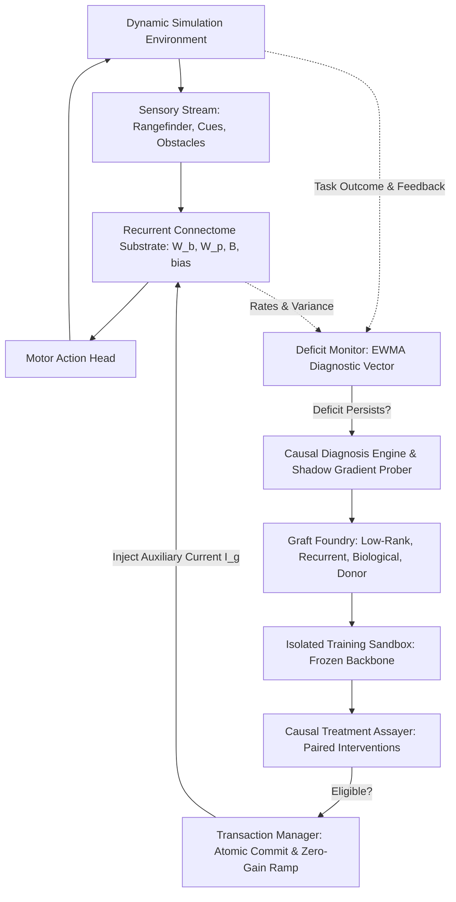

# SONAPSE-EVO System Architecture

SONAPSE-EVO is an experimental self-restructuring recurrent neural architecture combining causal diagnosis, targeted neural grafting, isolated sandbox training, and transactional commitment.

## Seven Core Subsystems

1. **Neural Substrate (`sonapse_evo.substrate`)**:
   Continuous rate recurrent connectome ($N=768$, 3 anatomical regions) driven by 155-dimensional observations and clamped auxiliary currents $\|\sum_g \mathbf{I}_g(t)\|_\infty \le 0.10$.

2. **Deficiency Detector (`sonapse_evo.diagnostics.deficit_monitor`)**:
   Tracks the 6-component diagnostic vector $\mathbf{d}_t = [e_{\mathrm{pred}}, e_{\mathrm{policy}}, u_{\mathrm{unc}}, c_{\mathrm{rep}}, r_{\mathrm{task}}, s_{\mathrm{stab}}]^\top$. Requires persistent deficit across multiple consecutive steps and performs an inexpensive no-growth adaptation probe before triggering structural evolution.

3. **Causal Diagnosis Engine (`sonapse_evo.diagnostics`)**:
   Hierarchical candidate location discovery evaluating virtual shadow gradients $s_{ij}^{\mathrm{grad}} = |\frac{\partial \mathcal{L}}{\partial W_{ji}^{\mathrm{virtual}}}|$ and counterfactual treatment effect $\hat{\tau}_g = \frac{1}{m}\sum_{s=1}^m [R_s(do(g=\mathrm{on})) - R_s(do(g=\mathrm{off}))]$.

4. **Graft Foundry (`sonapse_evo.grafts`)**:
   Constructs typed neural circuits:
   - **Type A**: Sparse low-rank factorized bridge ($U_g V_g$) with 50% parameter reduction.
   - **Type B**: Recurrent microcircuit graft with internal state memory $\mathbf{q}_t$.
   - **Type C**: Biological connectome motif obeying Dale's law.
   - **Type D**: External donor adapter (AETHER representation transfer).

5. **Learning Sandbox (`sonapse_evo.evolution.candidate_trainer`)**:
   Stage 1 training strictly freezes the backbone connectome ($W_b, W_p, B, \mathbf{b}$) and optimizes candidate weights using composite task, distillation, regularisation, and stability losses.

6. **Verification Engine (`sonapse_evo.evaluation`)**:
   Executes paired seed evaluations across 10 experimental arms (A0–A9), calculating recovery fraction $\mathcal{R}$, catastrophic forgetting $F$, and sample efficiency $T_\rho$.

7. **Evolution Controller (`sonapse_evo.evolution.transaction_manager`)**:
   Enforces atomic transactions: parent digest check, zero-gain initialisation ($\alpha_g(0)=0$), and non-destructive rollbacks upon any assertion failure.
